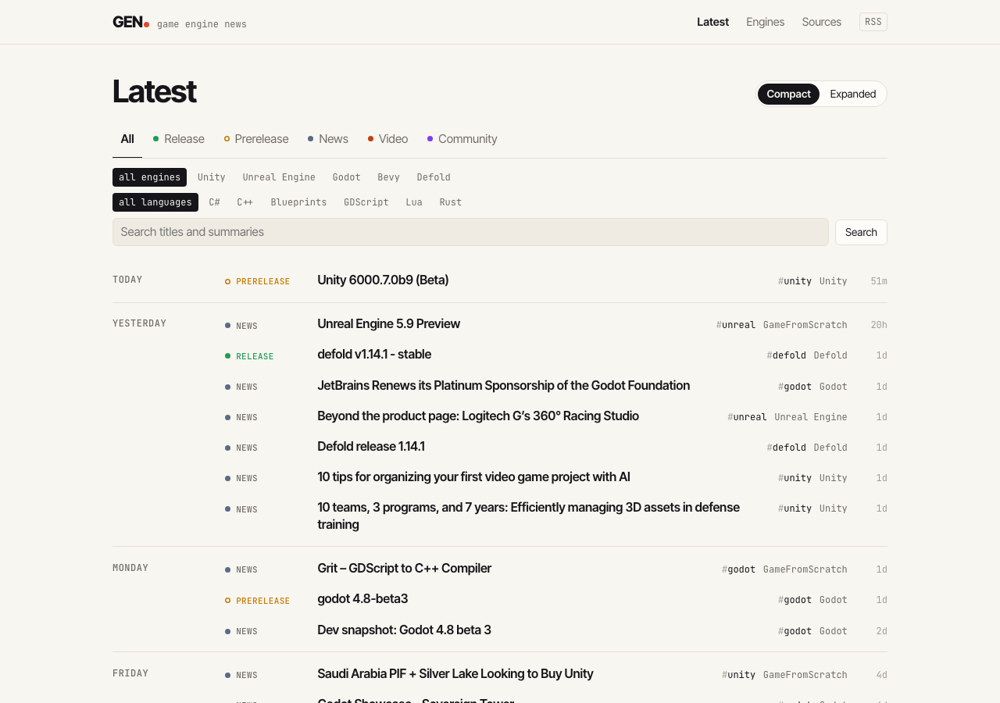
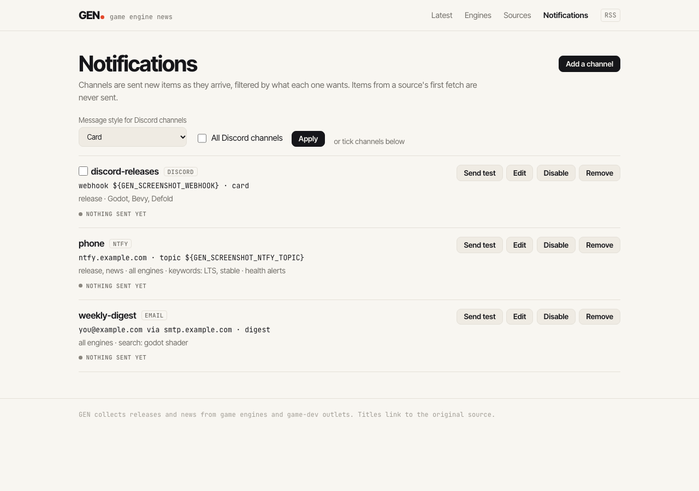
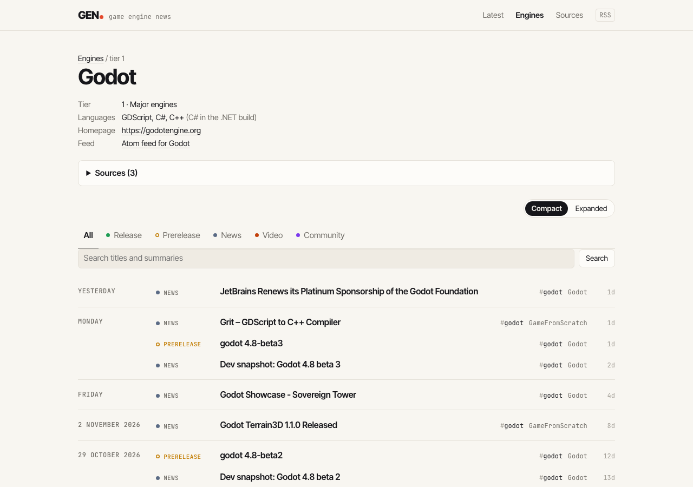
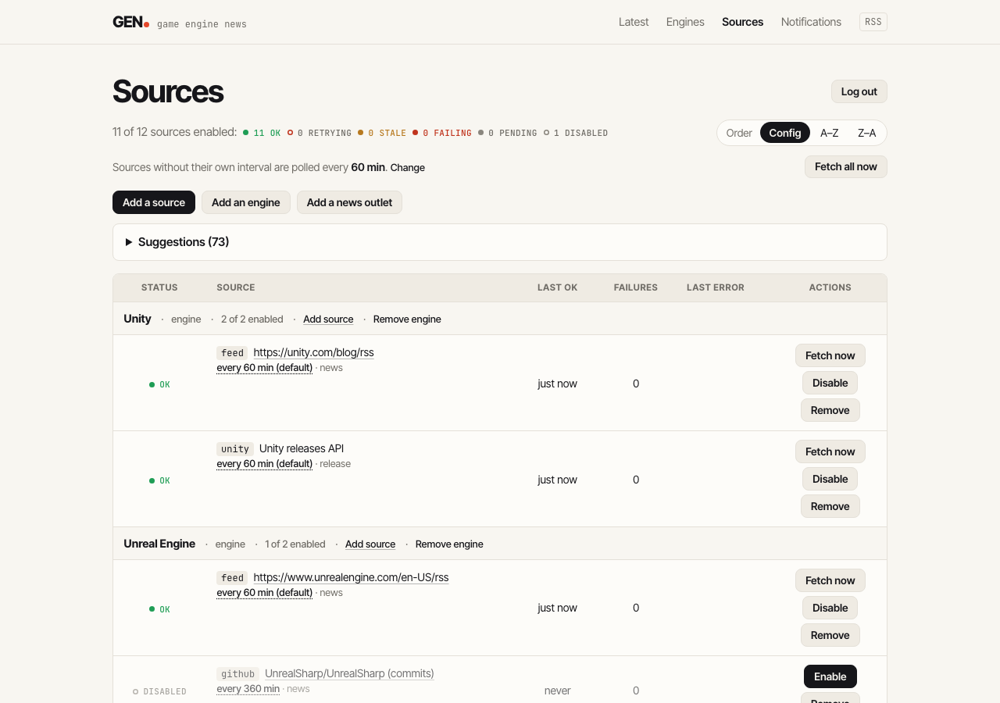

# GEN — Game Engine News

[](https://github.com/Thundernerd/GEN/actions/workflows/ci.yml)
[](https://github.com/Thundernerd/GEN/releases/latest)

GEN tracks new releases and news for game engines and collects them on one page, in one feed and in your notification channels. It covers engines of any language, from major engines to small frameworks and libraries:

- **Tracked engines:** Unity, Unreal, Godot, GameMaker, Defold, Bevy, Stride, Flax, S&Box, Fyrox, MonoGame, raylib and Phaser, among many others. Each engine lists the languages you write games in with it.
- **News outlets:** general game-dev outlets such as GameFromScratch. Their articles are tagged with the engines they mention.

GEN is a single Rust binary. It contains a web server and a background poller, and stores its data in SQLite.

<picture>
  <source media="(prefers-color-scheme: dark)" srcset="docs/screenshots/timeline-dark.png">
  
</picture>

## Features

- Polls RSS/Atom/JSON feeds, GitHub releases/tags/commits, the Unity release API, Hacker News searches and scraped HTML pages.
- Classifies each item as `release`, `prerelease`, `news`, `video` or `community`, and tags it with engines using per-engine aliases.
- Removes cross-source duplicates, for example the same release announced on GitHub, the engine blog and GameFromScratch.
- Provides a web UI by engine and by source, a combined Atom feed and a JSON API, with full-text search over item titles and summaries.
- Sends notifications to Discord, ntfy, email and Apprise API (which reaches Telegram, Slack, Matrix, Pushover and many more), with per-channel filter rules. Email can be sent as a digest.
- Runs an optional Discord bot. Server admins subscribe channels to engine topics with `/gen` slash commands, and `/gen setup` creates the channels, e.g. a Unity category with `#unity-releases` and `#unity-news`.
- Uses conditional requests (ETag / Last-Modified) and per-source intervals. The first fetch of a new source fills the database without notifying, so adding a source never floods your channels. Later fetches don't notify entries dated more than 2 days before the newest item the source already has, e.g. older entries that come into view when you raise a `limit` or change a `tag_prefix`; they are still stored and shown.

### How it works

`gen serve` loads `gen.toml` for app settings and reads the engines, outlets and sources from the database; a new database starts with Unity, Unreal Engine and Godot from the built-in catalog. It then starts an axum HTTP server and a scheduler. The scheduler polls each enabled source on its interval, with a limit on how many fetches run at once. Fetchers turn responses into raw items. The classifier assigns a kind and engine tags, and computes a normalized story key for deduplication. New items go into SQLite, and each item that matches a channel's rules is sent to that channel. The web UI and the feeds read from the same database.

## Download a release

Each [release](https://github.com/Thundernerd/GEN/releases) has prebuilt archives for Linux (x86_64 and arm64, glibc 2.35 or newer, so Debian 12 and Ubuntu 22.04 work) and macOS (Apple silicon), with a `SHA256SUMS` file. An archive contains the `gen` binary, the `templates/` and `static/` folders it serves, a default `config/gen.toml`, the systemd unit and the licence. Run it from the extracted folder:

```sh
tar -xzf gen-<version>-x86_64-unknown-linux-gnu.tar.gz
cd gen-<version>-x86_64-unknown-linux-gnu
./gen check-config
./gen serve
```

Every release is also a multi-arch Docker image (amd64 and arm64):

```sh
docker pull ghcr.io/thundernerd/gen:latest      # or pin: :1 (latest 1.x), :1.1 or :1.1.0
docker run -d --name gen -p 8080:8080 -v gen-data:/data ghcr.io/thundernerd/gen:latest
```

The [Proxmox VE script](#proxmox-ve-container) installs the latest release in an LXC container.

## Quick start (local)

Requires Rust 1.96 or newer (edition 2024). You don't need OpenSSL or a system SQLite: TLS uses rustls, and SQLite is compiled in.

```sh
cargo run -- check-config     # validate config/gen.toml, list the sources, the unhealthy ones and warnings
cargo run -- fetch            # poll every source once and print what's new (no notifications)
cargo run -- fetch --source godot   # only sources whose id contains "godot"
cargo run -- add bevy         # add a catalog engine or outlet, with its sources
cargo run -- serve            # web server + background polling
```

Then open <http://localhost:8080>. The database is created at `data/gen.db`.

CLI options, which work with every subcommand:

| Option | Env var | Default |
|---|---|---|
| `--config <path>` | `GEN_CONFIG` | `config/gen.toml` |

Logging uses `RUST_LOG`, for example `RUST_LOG=debug` or `RUST_LOG=gen=debug`. The default is `info`.

## Docker

The image is multi-stage. It builds on `rust:1.96-slim-bookworm` and runs on `debian:bookworm-slim` as a non-root user. It contains the binary (with the source catalog built in), `templates/`, `static/`, and `deploy/gen.docker.toml` as `/app/config/gen.toml`. Data lives in the `/data` volume, and the server listens on port 8080. A healthcheck polls `/health`.

### Compose (recommended)

```sh
cp deploy/.env.example .env      # GITHUB_TOKEN (recommended), other tokens and secrets
$EDITOR deploy/gen.docker.toml   # base_url, admin token
docker compose up -d --build
docker compose logs -f gen
```

`docker-compose.yml` does the following:

- builds the image and restarts it `unless-stopped`
- publishes `8080:8080`
- stores the database in the named volume `gen-data`, mounted at `/data`
- mounts `deploy/gen.docker.toml` as `/app/config/gen.toml` (read-only)
- reads `.env` if it exists, which is optional

Run the other subcommands in the container:

```sh
docker compose run --rm gen gen check-config
docker compose run --rm gen gen fetch
docker compose run --rm gen gen notify-test --channel phone
```

### Plain docker

```sh
docker build -t gen .
docker run -d --name gen -p 8080:8080 -v gen-data:/data --env-file .env gen
```

## Home server with systemd

`deploy/gen.service` runs the bare binary as a dedicated `gen` user. It uses `/opt/gen` as its working directory and `/var/lib/gen` as the only writable path. Hardening options include `ProtectSystem=strict`, `NoNewPrivileges` and `PrivateTmp`.

```sh
cargo build --release

sudo useradd --system --home-dir /opt/gen --shell /usr/sbin/nologin gen
sudo install -d -o gen -g gen /opt/gen /var/lib/gen
sudo install -m 0755 target/release/gen /usr/local/bin/gen
sudo cp -r templates static config /opt/gen/

# Point the database at the writable data dir:
#   [database]
#   path = "/var/lib/gen/gen.db"
sudo $EDITOR /opt/gen/config/gen.toml

# Optional secrets:
sudo install -d /etc/gen
sudo install -m 0600 deploy/.env.example /etc/gen/gen.env
sudo $EDITOR /etc/gen/gen.env

sudo cp deploy/gen.service /etc/systemd/system/
sudo systemctl daemon-reload
sudo systemctl enable --now gen
journalctl -u gen -f
```

`config/gen.toml` binds to `127.0.0.1:8080` by default. Change `bind` to `0.0.0.0:8080` to reach GEN from other machines, or put a reverse proxy (Caddy, nginx) in front of it, and set `base_url` to the public URL. To update, replace the binary or the files in `/opt/gen`, then run `sudo systemctl restart gen`.

## Proxmox VE container

`deploy/proxmox/ct/gen.sh` is a [community-scripts.org](https://community-scripts.org) script. It runs on their shared engine ([community-scripts/core](https://github.com/community-scripts/core)), so the GEN container is set up like every other community-scripts container: the same Default/Advanced wizard (container ID, storage, network, VLAN, SSH, password and so on), console auto-login when no root password is set, the community-scripts MOTD, the container notes in the Proxmox UI, and the `update` command. Only GEN's own two files come from this repository: `ct/gen.sh` and `install/gen-install.sh`.

Run this in the Proxmox VE node's shell:

```sh
bash -c "$(curl -fsSL https://raw.githubusercontent.com/Thundernerd/GEN/main/deploy/proxmox/ct/gen.sh)"
```

The defaults are an unprivileged Debian 13 container with 1 core, 512 MiB RAM and a 4 GiB disk, on x86_64 or arm64. GEN is installed from the latest [release](https://github.com/Thundernerd/GEN/releases), so nothing is compiled in the container. Presets work like in any community script, e.g. `var_ram=1024 var_disk=8 bash -c "$(curl …)"`.

GEN listens on port 8080 of the container's IP. Inside the container:
- `/etc/gen/gen.toml` holds the settings and `/etc/gen/gen.env` the secrets: the generated admin token, an optional `GITHUB_TOKEN` and an optional Discord bot token. Run `systemctl restart gen` after changes.
- `~/gen.creds` has the admin token and the login URL.
- The database is `/var/lib/gen/gen.db`, and `/opt/gen` holds the release files.

To update, run `update` in the container. When a newer release exists, it backs up the database to `gen.db.bak`, replaces `/opt/gen` and restarts GEN. Settings and data are kept.

**Containers from the old installer.** Before 1.0.0, `deploy/proxmox/gen.sh` built GEN from source. Their `update` still rebuilds from source, so switch them once by running the new script inside the container:

```sh
bash -c "$(curl -fsSL https://raw.githubusercontent.com/Thundernerd/GEN/main/deploy/proxmox/ct/gen.sh)"
```

It moves the settings from `/opt/gen/config` to `/etc/gen`, installs the release, removes the Rust toolchain and source tree, and replaces `update`. Data and secrets are kept. The old one-liner for `deploy/proxmox/gen.sh` still works: it now runs `ct/gen.sh`.

## Configuration

### gen.toml

String values can reference environment variables as `${NAME}`. If a referenced variable is unset, GEN refuses to start, so leave out any line you don't use. (References in notification channels are an exception: they're expanded when sending.) When `gen.toml` is missing, the defaults below apply.

```toml
[server]
bind = "127.0.0.1:8080"            # default 0.0.0.0:8080
base_url = "http://localhost:8080" # public URL, used in /feed.xml and notifications
templates_dir = "templates"        # default
static_dir = "static"              # default
# admin_token = "${GEN_ADMIN_TOKEN}" # enables the admin login; see "Managing sources from the web"

[database]
path = "data/gen.db"               # SQLite file; parent dir must be writable
# retention_days = 365             # delete older items once a day; unset (default) keeps everything

[polling]
default_interval_minutes = 60      # until changed on the Sources page; per source: interval_minutes
concurrency = 8                    # max sources fetched at the same time
# user_agent = "GEN/1.1.0 (Game Engine News aggregator)"
# github_token = "${GITHUB_TOKEN}" # optional; the GITHUB_TOKEN env var is used automatically

# [[notify.channel]]               # imported once, then managed on the website; see "Notifications"

# [discord]                        # runs the Discord bot; see "Discord bot"
# token = "${GEN_DISCORD_TOKEN}"
# dev_guild_id = 123456789012345678 # optional: register commands on this server only (instant)
```

Relative paths resolve against the working directory.

**Set a GitHub token.** It is optional, but recommended: with a token, `github` sources in `releases` mode use the GitHub API, which marks prereleases. Without one they read the public `releases.atom` feed, which has no prerelease flag (only a title such as `-beta` marks one), and every GitHub source polls github.com anonymously. A fine-grained token with no permissions is enough; put it in the `GITHUB_TOKEN` env var or `polling.github_token`. `gen check-config` warns, and `gen serve` logs a warning at startup, when GitHub releases sources are switched on without a token, with an estimate of the requests per hour they make. Tags and commits always use the Atom feeds.

When a host answers with a rate limit (HTTP 429, or GitHub's 403 with `x-ratelimit-remaining: 0`) and says when it resets (`Retry-After` or `x-ratelimit-reset`), every source on that host waits until then instead of retrying on its own. Only the source that got the rate limit counts as failing; the others are skipped, not failed: they keep their health on the Sources page, their skips are logged at `debug`, and "Fetch now", "Fetch all now" and `gen fetch` report them as skipped.

Without `retention_days`, the database keeps every item and grows without bound. With it, GEN deletes items that are dated, and were first fetched, more than that many days ago. It does so at startup and then once a day, and deletes their cross-source duplicates with them. It must be at least 7: the same story from different sources is merged when the two were published within 7 days of each other. GEN remembers each deleted item's source and id, so a feed that still lists an old entry doesn't bring it back as new or notify it again. It forgets them once the feed hasn't listed the entry for `retention_days`, keeping only each source's newest, so this record stays about as large as what your feeds currently list. An entry a feed drops for that long and then lists again comes back as new. SQLite reuses the freed space; the file doesn't shrink unless you run `sqlite3 gen.db VACUUM` while GEN is stopped.

### Engines, outlets and the catalog

Engines, outlets and their sources live in the database and are managed on the Sources page (see "Managing sources from the web"). The first start on a database adds the engines in `catalog::SEEDED` (Unity, Unreal Engine and Godot) with their sources, once. On a database from before sources moved into it, that first start also deletes the items and fetch state of sources that are no longer configured.

Everything else in the built-in catalog, `src/catalog.toml`, is offered as a suggestion on the Sources page. It includes other engines (tiers 1 and 2), frameworks and libraries (tier 3) and general news outlets. It has no YouTube, forum, Reddit or Hacker News sources. To change the catalog, edit `src/catalog.toml` and rebuild; existing databases keep what they have, except that on every start each stored engine gets the catalog `exclude` phrases it lacks (phrases are only added, never removed, and engines that aren't in the catalog are left alone). A stored engine keeps its tier even when the catalog moves it to another tier, since you may have chosen it. Engines stored before engines had `languages` keep loading: on the first start after the upgrade, catalog engines get their catalog languages and note, and other engines show their old C# text as the language note. Catalog engines whose language note is still the catalog's old C#-centred note (e.g. "C# via the UnrealSharp plugin") get the new language-neutral note once, on the first start after the upgrade; a note or languages you changed are left alone. A database that added Flame before its catalog entry moved to one releases source with `tag_prefix = ["v", "flame-v"]` is migrated once: on the first start after the upgrade, a Flame releases source still on the old `tag_prefix = "v"` gets both prefixes (keeping its interval and on/off state), and the old Flame tags source (`flame-v` tags from the 10-entry `tags.atom`) stops being polled. Its items are kept until you remove Flame. Flame sources you changed are left alone.

There are two kinds of owners, and each has one or more `source` entries:

- **`[[engine]]`** is a game engine. Every item from its sources is tagged with that engine. Its `aliases` are also used to tag outlet articles that mention it.
- **`[[outlet]]`** is a general news site, such as GameFromScratch. Its items are tagged with any engine whose alias they mention. With `require_engine_match = true`, items that mention no engine are dropped.

```toml
[[engine]]
id = "stride"                    # unique; used in URLs and notify rules
name = "Stride"
tier = 1                         # 1 = major engine, 2 = smaller engine, 3 = framework or library
languages = ["C#"]               # what you write games in, primary first; at least one
# language_note = "Godot fork"  # optional, shown after the languages: only what the list can't say (rules in the catalog header)
homepage = "https://www.stride3d.net"
icon = "https://www.stride3d.net/favicon.png"  # optional PNG/JPEG/WebP logo for Discord messages
enabled = true                   # default true
aliases = ["stride", "stride3d", "stride engine"]   # case-insensitive whole words
exclude = ["stride length"]      # phrases that veto an alias match

  [[engine.source]]
  kind = "feed"
  url = "https://www.stride3d.net/feed.xml"
  category = "news"

  [[engine.source]]
  kind = "github"
  repo = "stride3d/stride"
  mode = "tags"                  # releases (default) | tags | commits
  tag_prefix = "releases/"       # only tags starting with this (or a list: ["v", "flame-v"])
  category = "release"
  interval_minutes = 30          # override the default polling interval

[[outlet]]
id = "gamefromscratch"
name = "GameFromScratch"
homepage = "https://gamefromscratch.com"
require_engine_match = false

  [[outlet.source]]
  kind = "feed"
  url = "https://gamefromscratch.com/feed/"
  category = "news"
```

**Source kinds**

| kind | Fields | Notes |
|---|---|---|
| `feed` | `url`, `cache_bust` (bool) | RSS, Atom or JSON Feed. `cache_bust` defeats stale CDN caches. |
| `github` | `repo` (`owner/repo`), `mode`, `tag_prefix` | Releases (with the prerelease flag), tags or commits. `tag_prefix` keeps only tags that start with it, or with any of a list (`tag_prefix = ["v", "flame-v"]` for a monorepo whose engine changed its tag scheme); with a token, a releases source with a `tag_prefix` reads the 100 newest releases instead of 30, so a monorepo's other packages don't push the matching release out. A bare version title is prefixed with the repo name minus a `-builds` suffix, so `godotengine/godot-builds` releases read `godot 4.8-beta3` and its stable releases merge with `godotengine/godot`'s. |
| `unity` | `limit` (default 25) | Unity editor releases API. |
| `hn` | `query` | Hacker News search via Algolia. |
| `html` | `url`, `item`, `title`, `link`, `date` | Scrapes a page. `item` is a CSS selector matching one element per entry; the others are relative to it. |

All source kinds also accept these fields:

- `category`: the default item kind
- `enabled`: whether the source is polled
- `interval_minutes`: overrides the default polling interval
- `keywords`: keeps only items whose title or summary contains one of them

**Categories / item kinds:** `release`, `prerelease`, `news`, `video`, `community`. The classifier can refine the category. For example, a `release` tagged `-beta` or flagged as a prerelease on GitHub becomes `prerelease`.

**Tiers:**

Tiers say how prominent and active something is and whether it's a full engine, not which language it uses; the languages show separately.

- Tier 1, major engines: widely used or very active full engines, such as Unity, Unreal, Godot, GameMaker, Defold, Bevy, Cocos, GDevelop, O3DE, Stride, Flax, S&Box, Fyrox, PlayCanvas and Babylon.js.
- Tier 2, smaller engines: niche, young or less active full engines, such as Prowl, OpenEngine, LODZERO, NeoAxis, Evergine, UNIGINE, Murder, Nu, CRYENGINE, Wicked Engine, Solar2D, Ren'Py, Panda3D and jMonkeyEngine.
- Tier 3, frameworks and libraries: frameworks, bindings and libraries for physics, ECS, networking, UI and more, such as MonoGame, FNA, Silk.NET, raylib, SDL, LÖVE, Phaser, three.js, libGDX, HaxeFlixel, Pygame, Flame, Arch, BEPUphysics and Mirror.

The tier only groups engines; it doesn't decide whether they are polled. Every catalog engine and outlet the database doesn't have, of any tier, is offered as a suggestion, and its sources are polled once you add it (see "Adding and removing sources, engines and outlets"). Catalog engines and outlets are always enabled; the catalog tests check this. A single catalog source with `enabled = false` is added switched off; switch it on from the Sources page (see "Switching sources on and off").

The `check-config` and `fetch` commands only see the sources stored in the database, so a new catalog entry is invisible to them until it has been added, from the suggestions or with `add`. To add an engine or outlet to the catalog and try it out:

1. Add the `[[engine]]` or `[[outlet]]` block (or an `[[engine.source]]` / `[[outlet.source]]` entry under an existing one) to `src/catalog.toml`.
2. Run `cargo test catalog`, which checks that the catalog parses, is valid and has no Hacker News sources and no YouTube, Reddit or Discourse (`/latest.rss`) URLs.
3. Try it on a scratch database, so your real one stays untouched. Write a scratch config, e.g. `data/scratch.toml` (`data/` is ignored by git):

   ```toml
   [database]
   path = "data/scratch.db"
   ```

   Then add the entry and poll its sources once:

   ```sh
   cargo run -- --config data/scratch.toml add <id>              # prints the sources it added
   cargo run -- --config data/scratch.toml fetch --source <id>   # prints the first fetch's items
   ```

   `fetch --source` polls every source whose id contains the text, so a short id can pull in other entries' sources too. `add` lists sources added switched off as `(switched off)`; `fetch` skips them. `add` fails if `<id>` isn't in the catalog or the database already has it. A new database already has the seeded engines (Unity, Unreal Engine and Godot), so for those skip `add` and just `fetch`. A later `fetch` prints only the items that are new since then (usually none, or `not modified`). Editing `src/catalog.toml` doesn't change an entry a database already has, apart from new `exclude` phrases, which are added on the next start. To try a changed entry, delete `data/scratch.db` (with its `-wal` and `-shm` files) and repeat step 3.
4. Rebuild and restart the real server. The new entry shows under **Suggestions** on the real server's Sources page. You can also add it from the command line: stop the server, run `add <id>` with the real config, and start it again (a running server doesn't see what `add` stores until it restarts).

New sources fill the database silently on their first successful fetch.

## Notifications

<picture>
  <source media="(prefers-color-scheme: dark)" srcset="docs/screenshots/notifications-dark.png">
  
</picture>

Channels are managed on the **Notifications** page (`/notifications`), which shows in the header once you're logged in as admin (see "Admin login"). Each channel sends to Discord (a webhook), ntfy (phone push), email, or an [Apprise API](https://github.com/caronc/apprise-api) server, and has rules for what it gets:

- **Kinds:** the item kinds to send. All checked means everything, including kinds added later.
- **Engines:** only items tagged with one of these. None checked means every engine.
- **Also news-outlet items that mention no engine:** off by default.
- **Keywords:** the title or summary must contain at least one (case-insensitive).
- **Search:** works like the site's search box: every word must match the start of a word in the title or summary, ignoring case and accents. `godot shader` gets "Godot shaders explained" but not "Godot 4.8 released". Use it to have new items of a search you built on the timeline pushed to the channel.

**Health alerts** (off by default) also sends the channel a message when a source starts failing (see "Source health"), whatever its rules, e.g. "GEN: Godot feed https://godotengine.org/rss.xml is failing (3 failures in a row, last OK 2 days ago: unexpected status 404 Not Found from …)", with a link to the unhealthy sources on `/sources`. A source alerts once, when it goes from working (`ok`, `stale` or `retrying`) to `failing`; it doesn't alert again while it stays failing, nor when it recovers. A new source that fails on its first fetch doesn't alert either. A source that last fetched fine but wasn't fetched for days (GEN was stopped, or the source switched off) alerts on its next failed fetch. Alerts that can't be sent are retried like items, for up to three days.

Each channel shows its last delivery or error. **Send test** sends it something right away, ignoring its rules, so you can see how notifications look there: one of several examples (a release, a prerelease, a news post, an outlet article about two engines, one with no engine, summary or link, and one long enough to be cut short), all examples at once (one digest mail for a digest channel), or one of the newest real items. Changes take effect on the notifier's next run, which starts right after a change. A new channel only gets items that arrive after it was added, and switching a channel off keeps its place, so it catches up on items from the last three days when switched back on.

Secrets (the webhook URL, the ntfy topic and token, the SMTP password, the Apprise key, URLs and password) are never shown back on the page; leave a secret field empty when editing to keep it. Instead of the secret itself, you can enter an environment variable reference such as `${GEN_DISCORD_WEBHOOK}`: it's expanded when sending, so the secret stays out of the database. A reference is shown on the page as written.

### Discord message styles

Each Discord channel, webhook or bot, has a **message style**:

| Style | What it looks like |
|---|---|
| **Card** (default) | A card built from Discord's layout components: a coloured accent bar, the engine and kind, a large linked title, the summary, the version and type of releases, the source with a relative time, and link buttons, with the item's image or the engine's logo beside the text. |
| **Polished embed** | A full embed: the engine with its logo, the linked title, the summary with its bullet points, fields for version, type and source, a thumbnail, and link buttons. |
| **Compact embed** | A short embed for busy channels: the engine, the title, two lines of summary and the source. Up to ten items share a message. |
| **Big image** | An embed led by the item's large preview image. An item without an image is shown as a polished embed. |

The link buttons are **Release notes**, **Read article**, **Watch video** or **Open discussion**, plus **View on GEN** when `base_url` isn't a local address.

Discord only takes buttons and cards from a webhook when the request asks for them with `?with_components=true`, which GEN adds. If Discord still refuses them, GEN sends the polished embed without buttons instead and logs a warning.

Change a style in a channel's **Edit** dialog. To change several at once, use the **Message style** bar above the channel list: tick the channels (or choose **All Discord channels**), pick a style and click **Apply**. Bot channels can also be changed from Discord with `/gen style` (see "Discord bot").

**Images:** feed items keep the image their feed gives (a Media RSS thumbnail or image, an image enclosure, or the first real `` in the entry). For other items, GEN reads the `og:image` of the item's page, once, right before posting it to a channel whose style shows images (all but compact), and stores the result. Hacker News threads and GitHub release pages are skipped. Each engine can also have an `icon` (see the catalog format), shown next to its name and as the thumbnail of items without an image. The catalog engines come with icons, and databases from before icons existed get them once on the next start.

The **Send test** examples have no images, so the big image style shows them as polished embeds; send a recent item to see an image.

### Channels from gen.toml

Channels still configured as `[[notify.channel]]` in `gen.toml` are copied into the database on the first start after upgrading, keeping their `${VAR}` references and their delivery history. After that, `gen.toml` channels are ignored (GEN logs a line saying so), and you can remove them from the file. The format, for reference:

```toml
[[notify.channel]]
name = "phone"
kind = "ntfy"                    # or "discord" (webhook_url), "email" (smtp_host, smtp_port,
server = "https://ntfy.sh"       #   username, password, from, to = [...], digest) or "apprise"
                                 #   (server, key or urls, tag, username, password)
topic = "${GEN_NTFY_TOPIC}"
health_alerts = true             # also a message when a source starts failing
  [notify.channel.rules]
  engines = ["godot", "stride"]
  kinds = ["release", "news"]
  exclude_kinds = ["prerelease"]
  keywords = ["LTS"]
  search = "godot shader"        # every word must match, like the site's search box
  include_untagged = false
```

### Setup tips

- **Discord:** in the channel settings, open Integrations, then Webhooks, then New Webhook, and copy the webhook URL. Treat the URL as a secret.
- **ntfy:** choose a long, random topic name, because anyone who knows a topic on ntfy.sh can read it. Subscribe to it in the ntfy app or at `https://ntfy.sh/<topic>`. For a self-hosted server with access control, set the server and an access token.
- **Apprise API:** point the channel at your Apprise API server (e.g. `http://apprise:8000`). Either enter the **key** of a configuration saved there (`POST /notify/{key}`, optionally with a **tag** to pick some of its URLs), or enter **Apprise URLs** such as `tgram://bottoken/chatid` to send to directly (`POST /notify`, which needs the server's stateless mode). Messages are Markdown, with the summary and a link; releases are sent as type `success`, everything else as `info`. Set a username and password if the server requires Basic Auth.
- **SMTP:** use port 587 (STARTTLS). For Gmail or Fastmail, create an app password instead of using your account password. Set `digest = true` to avoid a mail per item.

To check a channel without waiting for news, use **Send test**, or from the command line:

```sh
gen notify-test --channel phone                  # the release example
gen notify-test --channel phone --sample all     # or: prerelease, news, outlet, untagged, long
```

## Discord bot

Besides webhooks, GEN can run a Discord bot. Server admins then manage what is posted where from Discord itself, and the bot can create the channels.

### Setting it up

1. In the [Discord Developer Portal](https://discord.com/developers/applications), create an application, open **Bot**, and copy (or reset) the token. The bot needs no privileged intents.
2. Put the token in the environment and add a `[discord]` section to `gen.toml`:

   ```toml
   [discord]
   token = "${GEN_DISCORD_TOKEN}"
   ```

3. Restart GEN. The Notifications page shows whether the bot is connected and has an **Add the bot to a server** link. The link asks for the View Channels, Send Messages, Embed Links and Manage Channels permissions; Manage Channels is only needed for `/gen setup`.

Slash commands are registered globally on startup, which can take a while to show up in Discord. While developing, set `dev_guild_id` to a server's id to register them on that server only, where they update right away. The bot connects to Discord over an outgoing websocket, so GEN doesn't need to be reachable from the internet. If the connection drops, it reconnects by itself.

### Commands

Every command needs the **Manage Channels** permission by default (server admins can change that under Integrations), and only the person who runs it sees the replies.

| Command | What it does |
|---|---|
| `/gen setup [engine]` | Opens a panel for picking engines, topics, a layout and a message style, with a **Create channels** button. The style applies to every channel the setup creates or reuses. Layouts: a category per engine with a channel per topic (Unity › `#unity-releases`, `#unity-news`, …), one channel per engine (`#unity`), or one channel per topic for all engines (`#releases`). The last two go in a "Game Engine News" category. Channels and categories that already exist with the same names are reused, so running setup again only adds what is missing. Discord menus hold 25 engines; for others, pass `engine:`. |
| `/gen subscribe engine topic [channel]` | Posts an engine's topic in an existing channel (default: the current one). Topic `Everything` subscribes to all four. |
| `/gen unsubscribe engine topic [channel]` | Stops that again. |
| `/gen list` | Shows every channel on the server with what it gets and its message style. |
| `/gen style style [channel \| engine \| everywhere] [default]` | Sets the message style (see "Discord message styles") of the current channel, another `channel`, every channel that gets an `engine`, or `everywhere` on the server. With `default:true` it also becomes the style new channels on this server get, and the one `/gen setup` preselects. |
| `/gen remove engine` | Stops posting the engine anywhere on the server. If that leaves channels the bot created without anything to post, it offers to delete them, and any category left empty. |

There are four topics:

- **releases:** releases and prereleases
- **news**
- **videos**
- **community**

A channel can be subscribed to several engines and topics, and an item that matches more than one of them is still posted once.

### On the Notifications page

Each subscribed Discord channel is listed as a **Discord bot** channel named after it (e.g. `discord-unity-news`). It works like other channels:

- it shows its last delivery or error
- it has **Send test**
- it can be switched off or removed
- it only gets items that arrive after it was subscribed

Its subscriptions are changed in Discord. On the website you can add keywords and a search, change its message style and switch it on or off. Deleting the channel in Discord, or removing the bot from the server, removes it here too.

## Web routes

<picture>
  <source media="(prefers-color-scheme: dark)" srcset="docs/screenshots/engine-dark.png">
  
</picture>

| Route | Description |
|---|---|
| `/` | Latest items from all enabled sources, grouped by day. Filter by kind, engine and language (`lang=Rust` keeps items about engines programmed in Rust; `lang=C#` also keeps news-outlet articles that mention C# or .NET). **Compact** shows one line per item (descriptions on hover); **Expanded** shows every description. The choice is remembered in a cookie and applies to engine pages too. |
| `/engines` | Engine list with tier, languages and recent activity. |
| `/engine/{id}` | Items for one engine. |
| `/sources` | Every source with its health, last fetch time and errors; `?health=unhealthy` lists only failing and stale sources. Admins can switch sources on and off, add sources, engines and outlets (by hand or from the suggestions) and remove them here. |
| `/notifications` | Admin only: notification channels, their rules and last deliveries. |
| `/view?mode=compact\|expanded` | Sets the timeline layout and goes back to the page it came from. |
| `/login`, `/logout` | Admin login with `server.admin_token`. |
| `/feed.xml` | Combined Atom feed. Takes `engine`, `kind` and `q`. |
| `/api/items` | JSON API for items. Takes `engine`, `kind`, `tier`, `lang`, `q`, `page` and `limit`. `csharp=1` is an alias of `lang=C#`. |
| `/health` | Liveness check that returns `ok`. |

**Search:** `/`, `/feed.xml` and `/api/items` take `q=` to search item titles and summaries; the timeline has a search box for it. Every word must match, as a word or the start of one (`god` finds Godot), regardless of case and accents. Punctuation is ignored, and words like `AND` or `NEAR` are searched for as words, not used as operators. Search combines with the other filters, so `/feed.xml?engine=godot&q=shader` is a feed you can subscribe to.

## Managing sources from the web

With `admin_token` set under `[server]`, the Sources page shows a **Manage sources** link. Log in with the token to manage sources without restarting. All changes are stored in the database and take effect right away. The buttons and forms update the page in place (via `static/inline-forms.js`); without JavaScript they work as ordinary form posts.

<picture>
  <source media="(prefers-color-scheme: dark)" srcset="docs/screenshots/sources-dark.png">
  
</picture>

### Source health

Each source on `/sources` and on the engine pages has a status:

| Status | Meaning |
|---|---|
| `ok` | Fetches fine and has had new items in the last six months. |
| `pending` | Not fetched yet. |
| `retrying` | The last one or two fetches failed, but it fetched fine recently (see `failing`). It's tried again on its next poll. |
| `failing` | 3 or more fetches in a row failed, or it hasn't fetched fine for over 3 days (or ever), e.g. a feed URL that now returns 404, or polling stopped. For sources polled less often than every 36 hours, the limit is two polling intervals instead of 3 days. |
| `stale` | Fetches fine, but its newest item is over six months old, or it has no items at all, e.g. an abandoned blog or a scraper whose selector no longer matches. Items deleted by `retention_days` still count for their source's newest item. |
| `disabled` | Switched off. |

Failing and stale sources count as unhealthy. The summary above the table counts each status, and **Show only unhealthy** lists just those sources. Admins also see how many sources need attention next to the page title. `gen check-config` lists the unhealthy sources with the reason, e.g. `failing  unity:feed:…  (3 failures in a row, never OK: HTTP 404)`. Channels with **health alerts** on get a message when a source starts failing (see "Notifications").

### Switching sources on and off

Each source (on `/sources` and on every engine page) gets an **Enable** / **Disable** button.

- The choice is stored in the database as an override of the source's own `enabled` flag, so it survives restarts. Catalog sources marked `enabled = false` are added switched off and can be switched on the same way.
- It takes effect immediately: a disabled source stops polling, and a re-enabled one polls right away. Items it already fetched stay visible.

### Fetching and polling intervals

- **Fetch now** (next to Enable / Disable) fetches a source right away, waits for the result and shows it, e.g. "Fetched Godot feed …: 2 new items" or the error. New items are notified as usual.
- **Fetch all now** (above the table) does that for every enabled source, within `concurrency`, and reports the totals. It waits up to 45 seconds; slower sources keep fetching in the background. While it runs, a progress bar shows how many are done, and each row shows whether it's queued or fetching. Every fetch is logged at `info`, with its new items, whether the source was unchanged, and how long it took.
- **every N min** under a source opens a small form for its own polling interval; leave it empty to use the default again. Saving fetches the source once right away.
- **Change** next to the default interval sets it for every source without its own (1 minute to 1 week). It's stored in the database and overrides `default_interval_minutes` in `gen.toml`. Sources pick up the new default after their current wait, so they aren't all fetched at once.

### Adding and removing sources, engines and outlets

- **Add a source** (a button at the top of `/sources` that opens a dialog, or the **Add source** link next to an engine or outlet, which preselects it) takes the same settings as a `[[engine.source]]` entry: a feed, GitHub repository or scraped HTML page, plus an optional category, interval and keywords. Input is checked first (URLs, `owner/repo`, CSS selectors), and a source that already exists is refused. A new source is polled straight away; its first fetch is stored without sending notifications.
- **Remove** (next to Enable / Disable) asks for confirmation, then stops polling the source and **deletes its stored items**, fetch state and on/off override. Items elsewhere that were duplicates of its items are shown in their place.
- **Suggestions** lists what the catalog has that you don't: engines grouped by tier, news outlets, and catalog sources missing from engines and outlets you have. **Add** adds an engine or outlet with all its catalog sources, or a single source. Something you removed shows up here again if it's in the catalog; adding it back fetches its items again.
- **Add an engine** and **Add a news outlet** (also dialogs) take an id (a lowercase slug, used in `/engine/{id}`), name and homepage. An engine also takes the tier, its languages (comma-separated, primary first; at least one) and an optional language note, aliases and exclude phrases, written as in the catalog (see "Engines, outlets and the catalog"); an outlet can be limited to items that mention a known engine. Either is added without sources and you're taken straight to adding its first one. New aliases tag items from the next fetch on.
- **Remove engine / Remove outlet** (in its group header) removes it with all its sources and their items; an engine's tags on other sources' items are removed too.

### Admin login

- The login sets an `HttpOnly`, `SameSite=Strict` cookie holding a hash of the token (also `Secure` when `base_url` is `https://`). Use a long random token, e.g. `openssl rand -hex 32`. Without a token, source and notification management is off.

## Development

```sh
cargo test
cargo clippy --all-targets
cargo fmt
```

To retake the README screenshots in `docs/screenshots/` after a change to the web UI, run `npm ci`, `npx playwright install chromium` and then `npm run screenshots` in `scripts/screenshots/` (see its [README](scripts/screenshots/README.md)). It needs Node.js 18 or newer; it builds GEN, serves it on a throwaway database with live items, and captures each view in light and dark mode.

Layout of `src/`:

| Module | Responsibility |
|---|---|
| `main.rs` | CLI (`serve`, `fetch`, `check-config`, `add`, `notify-test`) and wiring. |
| `config.rs` | `gen.toml` and engine/outlet/source schema, validation and `${ENV}` expansion. |
| `model.rs` | Shared types: `ItemKind`, `Topic`, `RawItem`, `NewItem`, `Item`, `SourceState`. |
| `fetch/` | HTTP client and one fetcher per source kind: `feed`, `github`, `unity`, `hn`, `html`. |
| `classify.rs` | Item kind detection, engine tagging by alias and story keys for deduplication. |
| `health.rs` | Source health (ok, retrying, failing, stale …) from fetch state and newest item. |
| `time_ago.rs` | Relative times such as "3 hours ago", for the web UI and `check-config`. |
| `store.rs` | SQLite storage: items, source state, engines/outlets/sources and queries for the web UI. |
| `catalog.rs` | The built-in catalog (`catalog.toml`): seeding a new database, merging catalog excludes into stored engines, and the suggestions. |
| `registry.rs` | The live set of sources stored in the database, published to the web UI, pipeline and scheduler. |
| `pipeline.rs` | Polls a source: fetch, classify, dedupe and store, and queue a health alert when it starts failing. |
| `notify/` | Rule matching and delivery: `discord` (webhooks and bot channels), `ntfy`, `email`, `apprise`; `alert` for health alerts. |
| `discord_bot/` | The Discord bot: gateway connection, `/gen` commands, channel layout for `/gen setup`, and subscriptions stored as notification channels. |
| `web/` | axum router: HTML pages (minijinja templates), Atom feed, JSON API. |

Runtime assets are in `templates/` (minijinja) and `static/` (CSS and other static files). Deployment files are in `deploy/`, `Dockerfile` and `docker-compose.yml`.

### CI and releases

Every pull request and push to `main` runs `.github/workflows/ci.yml`: `cargo fmt --check`, `cargo clippy -D warnings`, `cargo test`, `gen check-config`, and a Docker build. Run the same checks locally before pushing:

```sh
cargo fmt --all --check && cargo clippy --all-targets --locked -- -D warnings && cargo test --locked
```

To release, bump `version` in `Cargo.toml` (and the `user_agent` example above), merge that to `main`, then push a matching tag:

```sh
git tag -a v0.2.0 -m "GEN 0.2.0" && git push origin v0.2.0
```

`.github/workflows/release.yml` checks that the tag matches `Cargo.toml`, runs CI, builds the archives, publishes the Docker image to `ghcr.io/thundernerd/gen` (tags `0.2.0`, `0.2`, `latest`, and the major version from 1.0 on) and creates the GitHub release with generated notes. A tag with a suffix, such as `v0.2.0-rc.1`, becomes a prerelease and doesn't move `latest`.

## License

GEN is released under the [MIT License](LICENSE).
